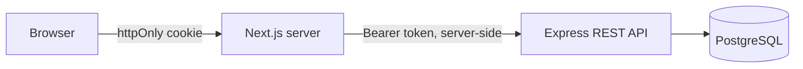

<div align="center">

# 🏥 Hospital Management Frontend (BFF)

### Feature-sliced Next.js frontend for an Express REST API

      

**[📦 Source](https://github.com/n1j10/Hospital-Management_M)**

</div>

---

## ✨ Overview

The frontend of the hospital platform, built as a **Backend-for-Frontend**. The browser never talks to the API directly: Server Components and Server Actions call the Express backend from the server and attach the user's token from an **httpOnly cookie**, so client-side JavaScript never sees the token.

## 🏗️ Architecture



**Feature-sliced structure.** Each domain keeps its own data access and UI:

```
src/
├── app/                 # routes only (thin pages)
├── features/
│   └── patients/        # every feature has the same shape
│       ├── actions.ts   # Server Actions (mutations)
│       ├── queries.ts   # server-side reads
│       ├── schemas.ts   # Zod validation
│       ├── types.ts
│       └── components/
├── components/          # shared UI (layout, forms, tables)
├── lib/                 # api-client, auth, formatting
└── proxy.ts             # route protection
```

## 🧩 Features

Dashboard · Patients · Doctors · Departments · Appointments · Consultations and prescriptions · Admissions and discharge · Pharmacy (low-stock, expiring) · Users · Per-user notification read state · Animated landing page

## 🔐 Security

Security was designed in from the start:

| Area | Implementation |
| --- | --- |
| Token handling | JWT in an **httpOnly, Secure, SameSite=Lax** cookie, read only on the server (`server-only` modules) |
| API calls | One typed `apiFetch` wrapper. Dynamic path segments are **URL-encoded**, so a crafted id can't reach another endpoint |
| Session expiry | A 401 from the API sends the user to `/logout`, which clears the stale cookie |
| Validation | Zod runs on every form before any network call |
| HTTP headers | HSTS, `X-Frame-Options`, `nosniff`, `Referrer-Policy`, `Permissions-Policy`; `X-Powered-By` removed |

> Secrets are stored only in environment variables. `.env*` is git-ignored, and `.env.example` contains placeholders only.

## 🚀 Getting Started

```bash
npm install
cp .env.example .env   # API_URL=http://localhost:5000/api
npm run dev
```

## ☁️ Deployment

Deployed on **Vercel**. Add the variables from `.env.example` under *Project → Settings → Environment Variables*, then push. Vercel builds and deploys automatically.

Set `API_URL` to the deployed backend URL.

## 👤 Author

**n1j10**, full-stack engineer (Next.js · TypeScript · Node.js · PostgreSQL)

[](https://github.com/n1j10)

> If you find this project useful, a ⭐ on the repo is appreciated.
